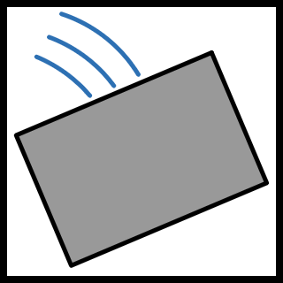

# Antigravity
(Not to be confused by that "agentic development platform")

*Note: this mod is in beta. Things have been somewhat tested, but there may still be issues.*

Makes any UI have gravity (how ironic)
- Doesn't matter what it is or what source it came from.
- This differs from other physics-based mods that, to the best of my knowledge, only work on a subset of the game's UI.

## Features
Adds physics (why not?)
- Agnostic to any UI layer. In other words: It should work regardless of if it's RobTop's menus or some mod's strange UI.
    - Currently works, but all anchor points are adjusted. This may cause issues if some UI element really relies on it.
- Tunable

## Dependencies
[`box2d`](https://box2d.org/) (For physics)

## Limitations
(or a roadmap)

Currently, consists of some of the following:
- Nine slices seem to fall apart sometimes.
- Highly complex, layered scenes may not be perfect.
